# Sabores de México — Recetario de cocina mexicana

Proyecto final integrador de **Programación Web**: una aplicación web hecha con **React + Vite** que consume
una API personalizada (un archivo JSON alojado en este mismo repositorio de GitHub) con recetas tradicionales
de distintas regiones de México.

| Entregable | Enlace |
| --- | --- |
| Repositorio | https://github.com/KevinLlamas0203/Proyecto-Final-React-Programacion-Web |
| API (JSON raw) | https://raw.githubusercontent.com/KevinLlamas0203/Proyecto-Final-React-Programacion-Web/main/api/recetas.json |
| Aplicación en Netlify | _pendiente: pegar aquí la URL pública de Netlify_ |
| Capturas de pantalla | Carpeta [`capturas/`](capturas/) (galería al final de este documento) |

---

## Fase 1 — La API (JSON)

- **Tema:** recetario de cocina mexicana.
- **Archivo:** [`api/recetas.json`](api/recetas.json), un arreglo con **21 recetas**.
- **Imágenes:** [`api/imagenes/`](api/imagenes/). Son fotografías de Wikimedia Commons con licencias libres,
  servidas también desde GitHub raw. El autor y la licencia de cada foto vienen en el campo `creditoImagen`.

Campos de cada registro:

| Campo | Tipo | Descripción |
| --- | --- | --- |
| `id` | número | Identificador único |
| `nombre` | texto | Nombre del platillo |
| `descripcion` | texto | Descripción e historia del platillo |
| `imagen` | URL | Foto pública del platillo |
| `categoria` | texto | Antojito, Plato fuerte, Sopa, Desayuno, Postre o Bebida |
| `region` | texto | Estado o región de origen |
| `tiempoPreparacion` | número | Minutos aproximados |
| `porciones` | número | Porciones que rinde |
| `dificultad` | texto | Fácil, Media o Difícil |
| `picante` | número | Nivel de picante de 0 a 3 |
| `ingredientes` | arreglo | Lista de ingredientes |
| `preparacion` | arreglo | Pasos de la receta |
| `creditoImagen` | objeto | `autor`, `licencia` y `fuente` de la foto |

## Fase 2 — Entorno

- Proyecto creado con `npm create vite@latest` (plantilla **React**).
- Dependencia de enrutamiento: **React Router DOM**. Las peticiones se hacen con **fetch nativo**, sin librerías extra.
- Se eliminaron los archivos y estilos de ejemplo de la plantilla.

```
├── api/                    # La "API": recetas.json + imágenes
├── capturas/               # Capturas de pantalla para la entrega
├── public/                 # favicon e imagen de respaldo
├── src/
│   ├── components/         # Navbar, Footer, RecipeCard, RecipeList, RecipeDetail, Loader, ErrorMessage...
│   ├── config/api.js       # URL de la API y constantes
│   ├── hooks/              # useFetch, useRecetas, useTituloPagina
│   ├── pages/              # HomePage, DetailPage, AboutPage, ContactPage, NotFoundPage
│   ├── styles/             # global.css + un archivo CSS por componente o página
│   ├── utils/formato.js    # Funciones de apoyo (formato de tiempo, búsqueda sin acentos)
│   ├── App.jsx             # Componente raíz y rutas
│   └── main.jsx            # Punto de entrada (BrowserRouter)
└── netlify.toml            # Configuración de despliegue
```

## Fase 3 — Componentes

| Componente | Función |
| --- | --- |
| `App` | Componente raíz: estructura general (navegación, contenido, pie) y rutas |
| `Navbar` | Menú de navegación con `NavLink`; se convierte en menú hamburguesa en celular |
| `RecipeCard` | Tarjeta reutilizable (imagen, título y botón **Ver más**) que recibe todo por props |
| `RecipeList` | Recorre el arreglo con `map` y renderiza una `RecipeCard` por receta |
| `RecipeDetail` | Información completa: datos, ingredientes marcables y pasos de preparación |
| `AboutPage` y `ContactPage` | Páginas estáticas (Contacto incluye un formulario controlado con validación) |
| `Loader` y `ErrorMessage` | Indicador de carga y mensaje amigable de error con botón **Reintentar** |

## Fase 4 — Estado y consumo de la API

- **`useState`**: guarda los datos, el estado de carga y el error ([`src/hooks/useFetch.js`](src/hooks/useFetch.js)).
- **`useEffect`**: hace la petición automáticamente cuando la aplicación se carga por primera vez.
- **Custom hooks**: `useFetch(url)` encapsula la lógica genérica y `useRecetas()` la reutiliza para el recetario.
- **Manejo de errores**: si la API falla, no hay internet, la respuesta no es válida o tarda más de 10 segundos,
  se muestra un mensaje amigable y un botón para reintentar.
- **Estado de carga**: se muestra un spinner animado mientras llegan los datos.

## Fase 5 — Enrutamiento

| Ruta | Página |
| --- | --- |
| `/` | Inicio con la lista, el buscador y los filtros por categoría |
| `/recetas/:id` | Detalle de una receta (**parámetro dinámico** leído con `useParams`) |
| `/acerca` | Acerca del proyecto |
| `/contacto` | Contacto |
| `*` | **Ruta comodín**: página 404 para cualquier URL que no existe |

Los enlaces del menú y de las tarjetas usan `Link`/`NavLink`, así que cambian de vista sin recargar la página.
Los botones **Volver** y **Regresar** usan **navegación programática** con `useNavigate`. Los filtros de
búsqueda se guardan en la URL (`?q=...&categoria=...`) y no se pierden al volver del detalle.

## Fase 6 — Estilos y diseño responsivo

- Paleta inspirada en México: rosa mexicano, cempasúchil, verde nopal y tonos de masa de maíz, definida con
  variables CSS en [`src/styles/global.css`](src/styles/global.css).
- Tipografías **Fraunces** (títulos) y **DM Sans** (texto) de Google Fonts.
- CSS Grid y Flexbox con `clamp()` y media queries, probado en celular (390 px), tableta (820 px) y escritorio (1366 px).
- Efectos al pasar el cursor: tarjetas que se elevan, zoom en imágenes, cambio de color en botones y enlaces,
  y animaciones suaves (se desactivan si el usuario prefiere menos movimiento).

## Fase 7 — Despliegue en Netlify

El archivo [`netlify.toml`](netlify.toml) ya incluye la configuración de construcción y la regla de
redirección que necesita React Router. Sin esa regla, recargar `/recetas/3` daría un error 404 en Netlify.

1. Entra a [app.netlify.com](https://app.netlify.com) e inicia sesión con tu cuenta de GitHub.
2. **Add new site → Import an existing project → GitHub** y elige `Proyecto-Final-React-Programacion-Web`.
3. Netlify lee `netlify.toml` y rellena solo los campos:
   - Build command: `npm run build`
   - Publish directory: `dist`
4. Clic en **Deploy**. Cuando termine, abre la URL pública (`https://<nombre>.netlify.app`) y comprueba que
   carguen las recetas, el detalle, las páginas estáticas y la página 404.
5. (Opcional) En **Site configuration → Change site name** puedes ponerle un nombre como `sabores-de-mexico-kevin`.

Cada `git push` a `main` vuelve a desplegar la aplicación automáticamente.

## Ejecutar en local

```bash
npm install
npm run dev       # servidor de desarrollo en http://localhost:5173
npm run build     # build de producción en dist/
npm run preview   # sirve el build de producción
npm run lint      # revisión de código con oxlint
```

Para probar el mensaje de error se puede apuntar a una URL que no existe:

```bash
VITE_API_URL=https://raw.githubusercontent.com/KevinLlamas0203/noexiste.json npm run dev
```

---

## Capturas de pantalla

| Inicio | Búsqueda y filtro |
| --- | --- |
| 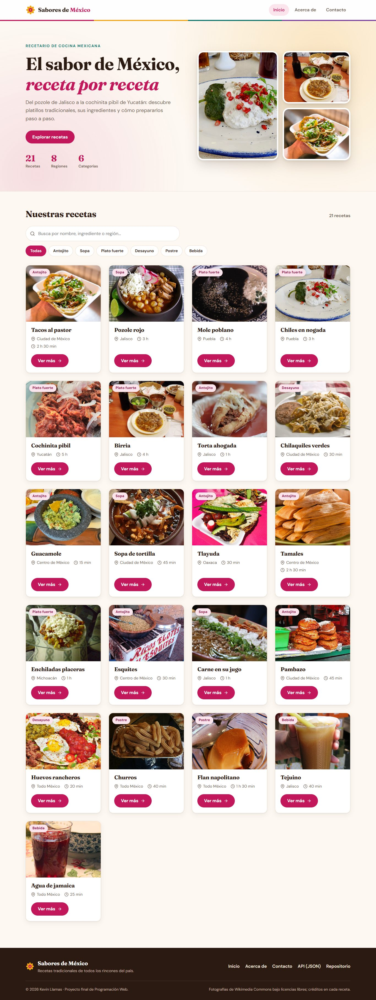 | 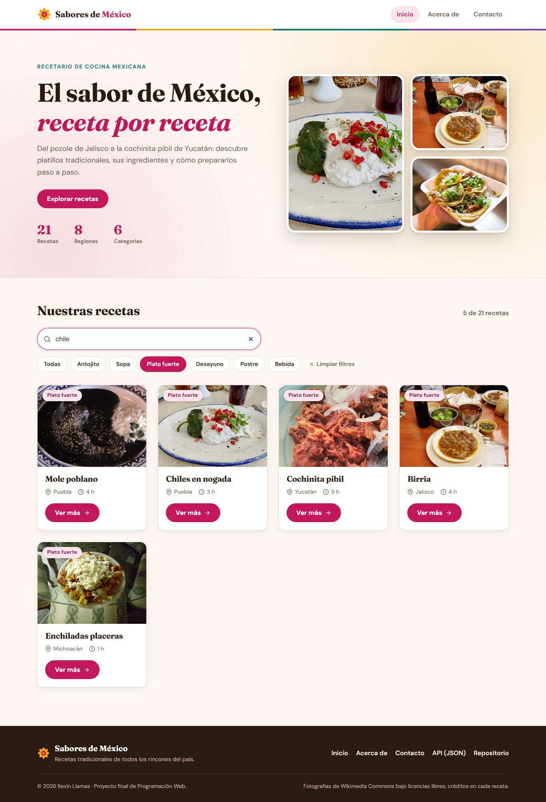 |

| Detalle de receta | Acerca de |
| --- | --- |
| 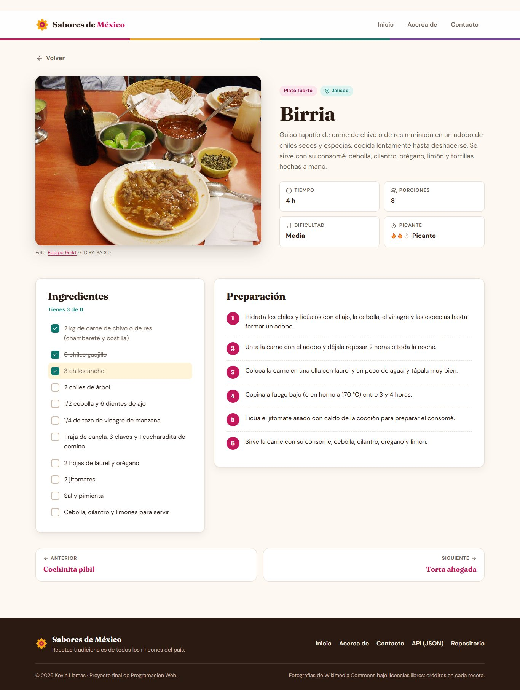 | 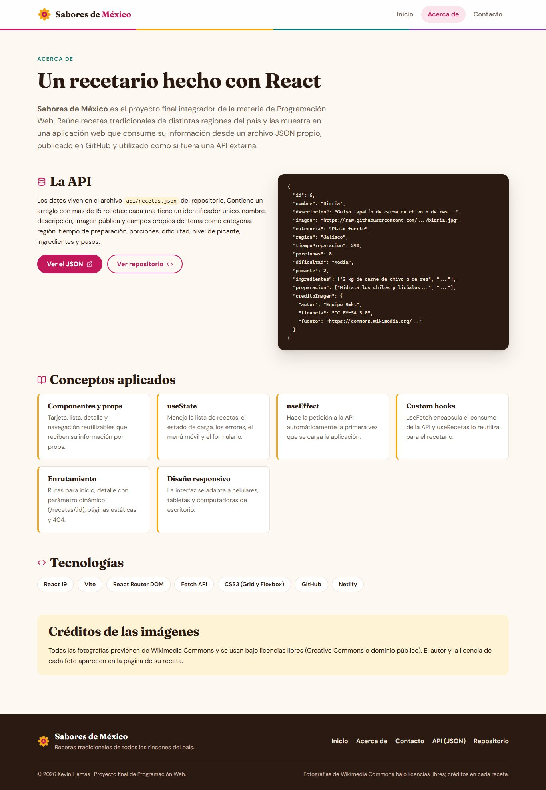 |

| Contacto (validación) | Página 404 |
| --- | --- |
| 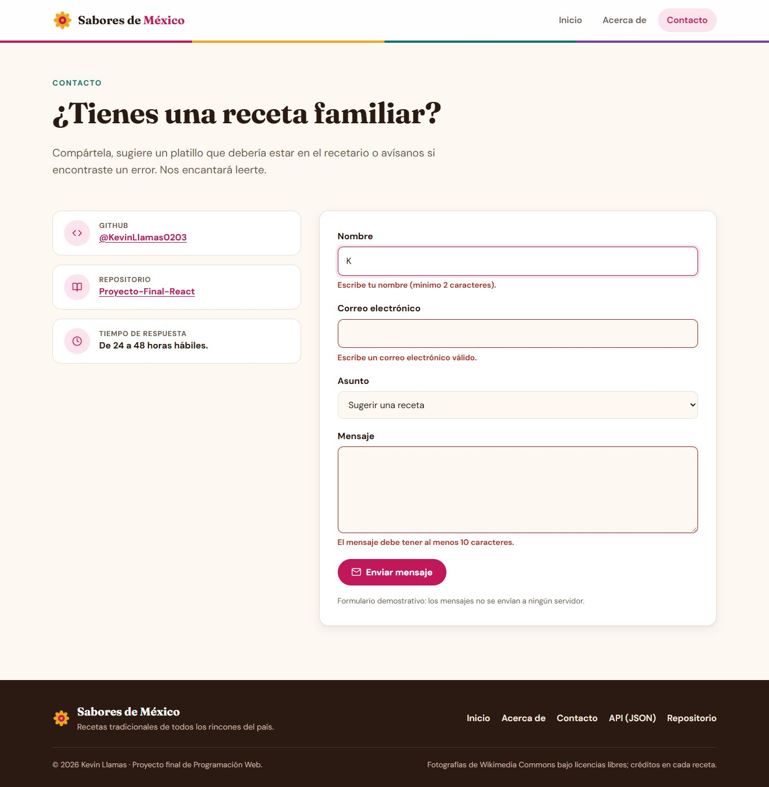 | 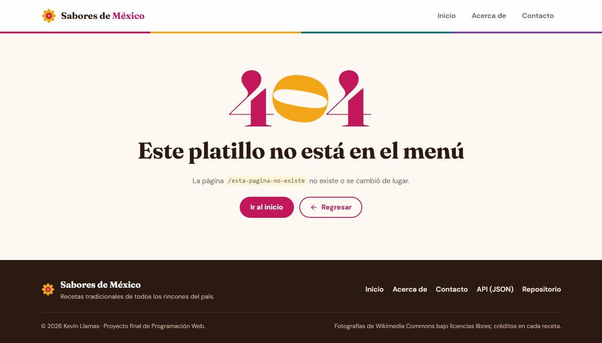 |

| Receta no encontrada | Estado de carga | Error de conexión |
| --- | --- | --- |
| 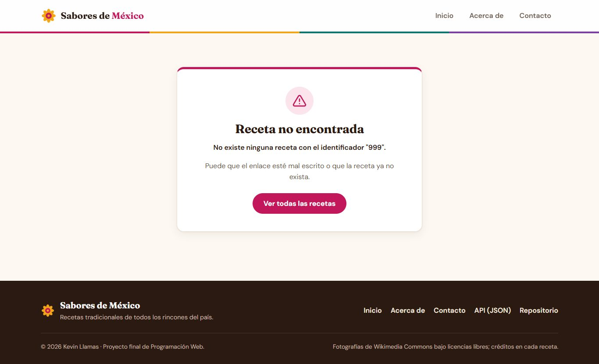 | 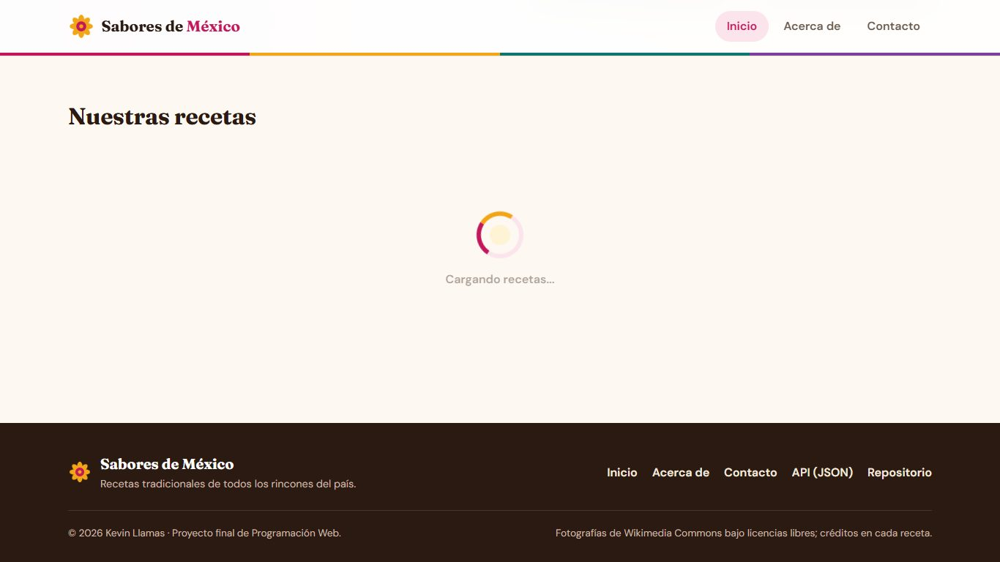 | 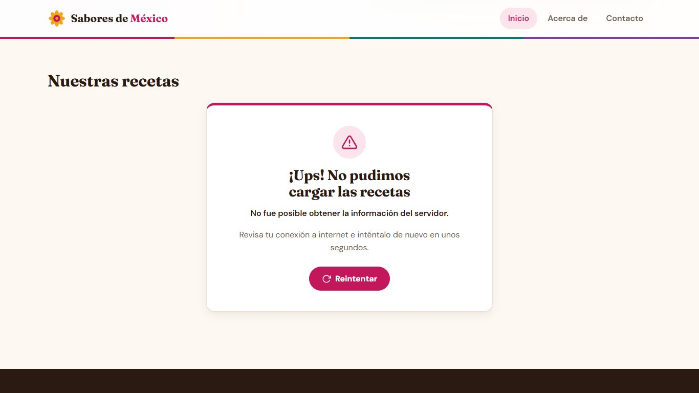 |

| Tableta | Móvil | Menú móvil | Detalle en móvil |
| --- | --- | --- | --- |
| 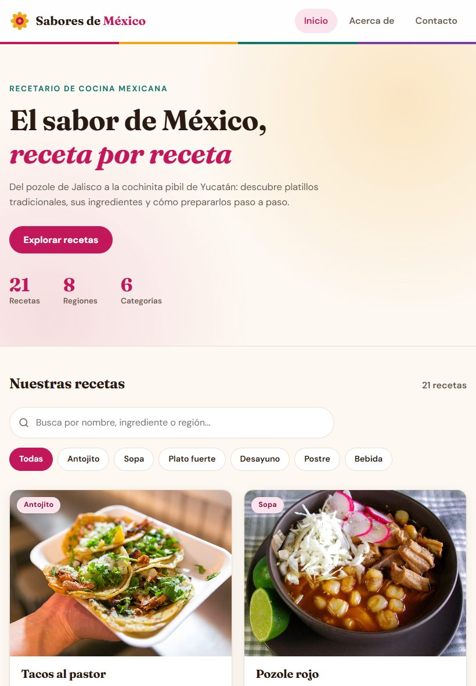 | 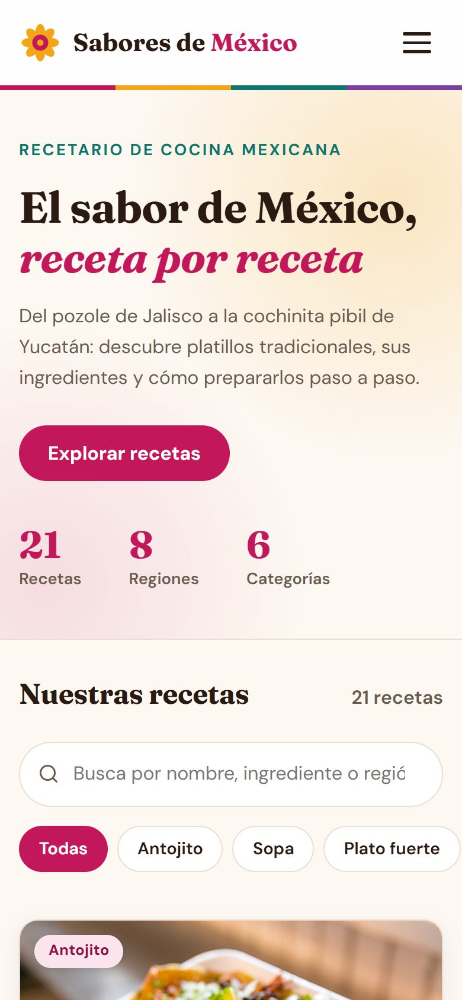 | 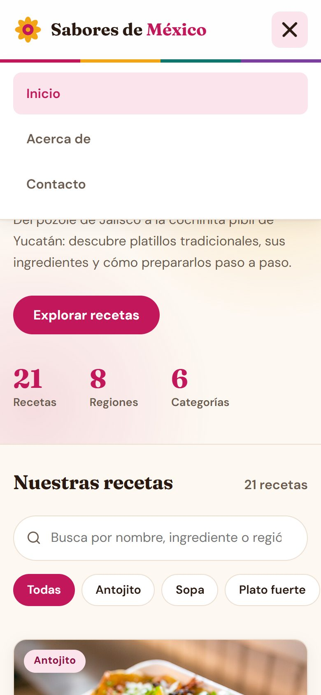 | 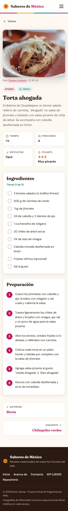 |

---

Desarrollado por **Kevin Llamas** · Fotografías: Wikimedia Commons (licencias Creative Commons y dominio público).
